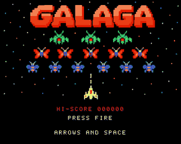
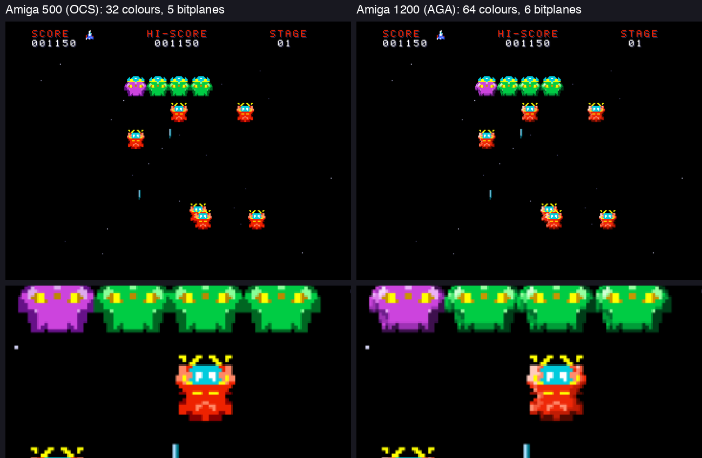
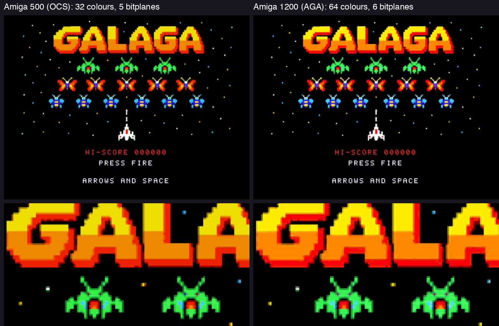

# Galaga for the Amiga

[**▶ Play it in your browser**](https://vamigaweb.github.io/#AROS=true#https://raw.githubusercontent.com/Shadester/galagas/master/amiga/docs/galaga.adz) (vAmigaWeb, with its own AROS ROM: no Kickstart needed)

A port of the Galaga clone to the Commodore Amiga (PAL). One bootable floppy disk runs on an **Amiga 500** (68000, OCS or ECS chipset) and on an **Amiga 1200** (AGA chipset, 68020 and up): the game finds out what it runs on at start-up. It starts from the boot block and takes over the whole machine. There is no AmigaOS in it.



The rules are the rules of the PSP game, the arcade rules: the game uses `../psp/game.c` itself (the reference). It is compiled without floating point (the arcade paths are a table). A test runs the 68000 build in an emulator and compares the whole game state with the build on the Mac, for 15000 ticks.

## One disk, two machines

| | Amiga 500 (OCS / ECS) | Amiga 1200 (AGA) |
|---|---|---|
| Found by | no Lisa chip ID | `DENISEID` is $F8 (the boot block reads the AGA data only then) |
| Screen | 5 bitplanes, 32 colours | 6 bitplanes, 64 colours; 64-bit bitplane fetch (FMODE 3: a quarter of the DMA slots) |
| Aliens | 4 tones for each colour | 7 tones for each colour (the same drawing, more tones), lit from the upper left |
| Title | 32 colours | 64 colours |
| Processor | 68000 | the instruction cache is switched on (68020 / 68030 / 68040 / 68060; the data cache stays off) |
| Formation sway | the copper shows the play area shifted | drawn where it is: a 64-bit fetch cannot start early enough for a scroll |
| Speed (busy autoplay) | about 80 % of the 50 pictures a second | about 99 % (in FS-UAE) |

**Gameplay, the same moment (tick 950 of the autoplay build).** Left: what an Amiga 500 shows. Right: an Amiga 1200. Below: a part of each picture, enlarged. The AGA aliens have 7 tones for each colour instead of 4 (smoother shading); the sprites are in the same places.



**Title picture.** Left: 32 colours. Right: 64 colours (the smooth orange of the logo).



Both pictures of each pair come from FS-UAE as an A1200. The left one is the same disk with `-DFORCE_OCS`: the game then plays the OCS game that an A500 plays. `tools/make_aga_compare.py` makes the two figures. `tests/compare_aga.py` checks that every sprite is in the same place in both.

The ECS chipset (A500+, A600) plays the OCS game. Everything is in one binary: `-DFORCE_OCS` makes an A1200 play the OCS game, which is how the two are compared (`tests/compare_aga.py`).

## Status

It runs in vAmigaWeb (A500) and in FS-UAE (A500, A500+, A1200 with a 68EC020, 68030 and 68040). The rules, the pictures and the keyboard are tested there. **The sound has not been heard**: it is checked by reading the code only. It has not been tried on a real Amiga.

## Features

The same features as the other versions: 40-alien formation with fly-in waves and dives, bosses that take two hits, tractor beam capture, rescue and dual fighter, challenge stages with a 10,000 bonus, a shots / hits / ratio screen after each stage, bonus ships, title picture, jingles and sound effects.

What is different:

- The play area is 320 x 200 pixels, the same as the C64: the game keeps the C64 coordinates, and an alien is the C64 sprite (24 x 22 pixels). The hud (score, hi-score, stage and the lives) is above the play area. The copper shows the play area shifted to the left or right, so the formation sways without being drawn again.
- 32 colours, 5 bitplanes. The aliens, the fighter and the explosions are drawn by hand (`../art`: scripts, shared with the PSP version), at their own size: 24 pixels wide, 4 tones for each colour (7 on an AGA machine). The fighter and its shots are hardware sprites (the fighter: two attached sprites, 15 colours, 16 pixels wide; the stars and the shots use sprites 4 to 7). The aliens and bombs are drawn by the blitter into a buffer that is not shown (three buffers). Text is made of sprites too, so it needs no CPU. The hot loops are in assembly (`src/fast.s`, with the same code in C for tests).
- The tractor beam is a cone of thin rings, like the arcade's (4 rows of 4 rings; a light ring runs down it). The blitter draws each row as one sprite (16 pictures: 4 rows, 4 phases). The explosions are bursts of scattered pixels (5 steps for an alien, 6 for the fighter). The stars are hardware sprites (two layers, in fixed columns, as in the arcade game).
- Sound is made by Paula: 8-bit samples for the effects (made by `tools/gen_assets.py`) and a square wave for the jingles.
- **The hi-score is not saved.** It stays until you reset the machine. Writing to the floppy disk is too risky.

## Controls

| Keyboard | Joystick, port 2 | Action |
|---|---|---|
| Cursor left / right, or A / D | Left / right | Move the ship |
| Space, Z, X, Return or Ctrl | Fire button | Fire, start the game |
| P | | Pause / resume |
| Esc | | Quit to the title screen |

## Build and run

`tools/setup-macos.sh` installs everything with Homebrew: `m68k-elf-gcc`, `m68k-elf-binutils`, FS-UAE and Pillow. The tests also need a C compiler (`cc`).

```sh
make                 # build/galaga.adf: a 880 KB floppy disk image
tools/run-ocs.sh     # build, then run it in FS-UAE as an Amiga 500 (OCS)
tools/run-aga.sh     # the same as an Amiga 1200 (AGA, 68020; needs your Kickstart 3.1 ROM)
tools/run.sh         # build, then run it in FS-UAE (MODEL=A500|A1200 ...)
make web             # docs/galaga.adz: the same, gzipped (for the link above)
python3 tools/gen_assets.py [preview.png]   # src/assets.h: sprites, title picture, font, sound
python3 tools/make_gif.py                   # record docs/gameplay.gif (about 2 minutes)
```

To play it, run `tools/run.sh`: it starts the `.adf` in FS-UAE (`brew install --cask fs-uae-emulator`) in a window, with the AROS replacement ROM that is inside FS-UAE. (`KICKSTART=file` uses a Kickstart ROM instead. vAmiga cannot take a disk from the command line.) On a real Amiga, write the ADF to a floppy disk.

The tests run the game in vAmigaWeb in a headless browser. Install it once: `pip install playwright pillow && playwright install chromium`.
The tests of the Amiga 1200 run FS-UAE (`tests/fsuae.py`; the Kickstart ROM is your own, in `~/Documents/FS-UAE/Kickstarts`) and take a picture of its window only: macOS asks once for the permission Screen Recording. `pip install pyobjc-framework-Quartz`.

```sh
python3 tests/test_selftest.py   # the 68000 against the Mac: 4 scenarios, 3000 ticks (a number as argument: more)
python3 tests/shots.py           # screenshot tests (--update after a change you want)
python3 tests/compare.py         # a change for speed must not change a picture: this tree against a commit (--quick: 5 cases)
python3 tests/test_hw.py         # the rules on an A500, an A1200 (68020), a 68030 and a 68040 in FS-UAE (the detection and the caches)
python3 tests/compare_aga.py     # AGA against OCS on an A1200: every sprite in the same place
```

The game plays by the rules of the arcade Galaga (40 enemies, the arcade flight paths, dive scheduler and bombs; see `../ARCADE.md`).

Debug flags (`make EXTRA_CFLAGS="-DAUTOPLAY -DHALT=900"`): `AUTOPLAY` (the game plays itself), `HALT=n` (freeze after n ticks), `TITLE_HOLD=n` (ticks of the title screen in an autoplay build), `START_STAGE=n`, `FORCECAPTURE`, `SELFTEST=n`, `PROFILE` (with `HALT`: shows the loops of the main loop and the vertical blanks for the ticks: fewer loops = a slower picture), `PROFILE2` (and `PROF_FROM=n`: where the time goes), `FORCE_OCS`, `SHOWHW` (writes OCS or AGA on the screen), `SHOWBOMBS` (the two frames of the bomb in the corner), `FORCE_NPL6`, `AGA_FMODE0`, `NOSCROLL`, `SCROLLTEST=n`, `NOASM` (the C version of `fast.s`), `NOSKIP`.

## Source layout

| File | Contents |
|---|---|
| `src/game.c` | `psp/game.c` built without floating point |
| `src/main.c` | The main loop (one tick for each vertical blank), input, and what the game state looks like on the screen |
| `src/video.c` | Copper list, three bitmaps, blitter sprites (drawn again only when they change), text, the star sprites, the beam, the title picture, the hud that is drawn only when it changes |
| `src/audio.c` | Paula: effects on channels 0, 1 and 3, the jingles on channel 2 |
| `src/boot.s` | The boot block: loads the game into chip RAM and starts it in supervisor mode |
| `src/hw.s` | Start-up, the vertical-blank interrupt (50 Hz), the keyboard interrupt |
| `src/assets.h` | Generated: sprites, title picture, font, sound |
| `src/libc.c`, `src/inc/` | The few C library functions `psp/game.c` needs |
| `src/selftest.h` | The scripted game and its hash (the Mac and the 68000 both run it) |
| `tools/` | `setup-macos.sh`, `run.sh` (build and run in FS-UAE), `art.py` (palette and pixel art), `gen_assets.py`, `make_adf.py` (checksum of the boot block, the disk image), `make_gif.py` |
| `tests/` | `test_selftest.py` (+ `selftest_native.c`), `shots.py` + `ref/`, `vamiga.py` (runs an ADF in vAmigaWeb) |
