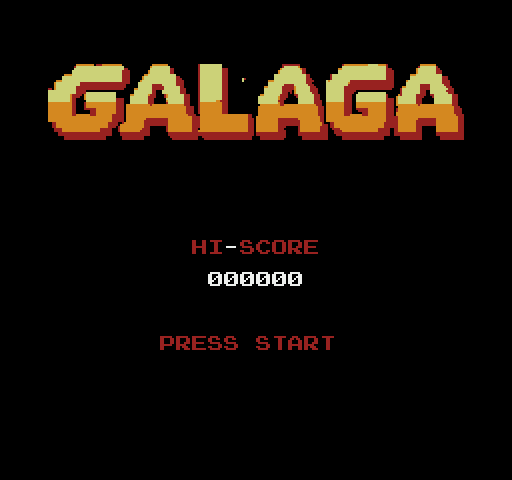

# Galaga for the NES

A Galaga clone for the Nintendo Entertainment System (and the Famicom), written in 6502 assembly ([ca65](https://cc65.github.io/), from the cc65 suite). The game rules are the rules of the Atari Lynx portrait game ([`../lynx`](../lynx)), which plays by the rules of the arcade Galaga. The NES side is new: the picture, the sound, the start-up and the cartridge.

[**▶ Play it in your browser**](https://shadester.github.io/galagas/nes/) (EmulatorJS)



The rules are the rules of the arcade Galaga (see [`../ARCADE.md`](../ARCADE.md)): 40 aliens, the arcade flight paths, dive scheduler and bombs, a formation that swings and breathes, and challenge stages of five waves. They are `../lynx/src/game/arc.s` (a translation of `../psp/game.c`) on the portrait field of the Lynx (x 0..203, y 0..253, 16 x 16 sprites), at 50 ticks a second. `../tools/compare_6502.py nes SCENARIO` runs the same game in the ROM and in that C code (built with `-DRULES_PORTRAIT`) and compares the state at checkpoints.

## Features

- 40-alien formation (4 bosses, 16 butterflies, 20 bees), fly-in waves on the arcade paths, dives with escorts, aimed bombs, bosses that take two hits
- Tractor beam capture, rescue of the captive, dual fighter
- Challenge stages (3, 7, 11, ...): five waves, 100 points a hit, 10,000 for a perfect clear
- Shots / hits / ratio screen, bonus ships at 20,000 and 70,000, game over
- Title logo, starfield, stage badges, jingles and sound effects (the two pulse channels and the noise channel of the APU)
- The hi-score is kept in the battery RAM of the cartridge
- NTSC and PAL: the game measures the frame and keeps 50 ticks a second on both (5 ticks in 6 frames on a 60 Hz NES)

## How the NES shows 40 aliens

The NES has 64 hardware sprites, but it shows at most 8 of them on one line. A row of 10 bees needs 20 sprites (a 16 x 16 alien is two 8 x 16 sprites). So an alien in the formation is not a sprite: it is four background tiles. The NES Galaga by Namco also draws its formation with background tiles.

- The background tiles are on a grid of 8 pixels. The game puts an alien in the formation at the cell that is nearest to its position (`form_sync` in `src/game/view.s`). The formation moves in steps of 8 pixels, and the columns move by different numbers of steps when the formation breathes.
- The two pattern tables have the same background tiles, but the formation tiles of table 0 have the wings up and the tiles of table 1 have the wings down. One bit of `PPUCTRL` flaps the wings of all 40 aliens.
- An alien that flies (it flies in, dives, explodes) is a sprite at the pixel. The aliens that fly take turns at the front of the sprite list every frame. If more than 8 are on one line, they flicker. They do not vanish.
- The attributes (palettes) are for areas of 16 x 16 pixels. The bosses have their own palette (green). The bees and the butterflies share one palette (blue, red, yellow). The boss row is always in the tile rows 2 and 3, and the other rows start at row 4.
- The tractor beam is background tiles too. The game draws its rings into CHR RAM at the pixel, centred under the boss, and copies the tiles to the PPU (2 tiles each frame). The three colours of its palette turn round, so a light ring runs down the beam.

## The screen

The field of the rules is 204 x 260 units. The NES screen is 256 x 240 pixels.

- x: a unit is 8 / 7 pixel. The formation columns are 14 units apart, so they are 16 pixels (two tiles) apart.
- y: a unit is one line in the formation's part of the field, so that the rows are 16 lines (two tiles) apart. Below the formation the field has fewer lines than units (0.73 lines a unit), so that the ship is at the line 215.
- `tools/gen_gfx.py` makes the two tables (`src/tables.s`, `xmap` and `ymap`).
- The HUD is in the top rows of the name table: the score and the hi-score, the spare ships, the stage badges (a 10, a 5 and a 1 flag).

## The cartridge

The board is an MMC1 board with CHR RAM and battery RAM (SNROM, iNES mapper 1), like The Legend of Zelda.

| Part | Size | Content |
|------|------|---------|
| PRG ROM | 64 KB | bank 0: the rules (`arc.s`) and the arcade data; bank 1: the graphics (copied to CHR RAM when the screen changes); bank 3 (fixed at `$C000`): the rest of the game |
| CHR RAM | 8 KB | the tiles of the game, or of the title screen |
| PRG RAM | 8 KB, battery | the variables of the game (the 2 KB RAM of the NES is too small), the name table copy, the hi-score |

The NES has no decimal mode (the 2A03 is a 6502 without it), so the BCD score uses `bcd_adc` (`src/game/progress.s`).

## Play it on a real NES

- Copy `build/galaga.nes` to the SD card of a flash cartridge, for example an Everdrive N8 or N8 Pro, or a PowerPak. They all play MMC1 (SNROM) games, also with the battery RAM.
- Or put it on a cartridge: an SNROM board (new from a reproduction maker, or from a donor cartridge) with a 64 KB or larger PRG chip (the ROM is the 64 KB after the 16 byte iNES header) and an 8 KB RAM for CHR. A front-loader NES needs a CIC lockout chip (or a clone) on the board.

## Build and run

Install cc65 (`apt install cc65`, or `brew install cc65`). Python with Pillow is for the generators; cynes (`pip install cynes`) is for the tests, and py65 (`pip install py65`) for `tools/prof.py`.

```sh
make                        # build/galaga.nes
tests/run.py                # screenshot tests, headless cynes; --update after an intended change
python3 ../tools/compare_6502.py nes arc_play   # the rules against ../psp/game.c ('list' shows the scenarios)
python3 tools/make_gif.py   # record docs/gameplay.gif
```

The web page is `../docs/nes/index.html`, and the ROM there (`../docs/nes/galaga.nes`) is a copy of `build/galaga.nes`: copy it again after a change.

## Controls

| Control | Action |
|---------|--------|
| D-pad left / right | Move the ship |
| A or B | Fire |
| Start | Start the game; pause / resume |
| Select | Quit to the title screen (a new hi-score is kept) |

## Tools

| Tool | Purpose |
|------|---------|
| `tools/gen_gfx.py` | Makes `gfx/game.chr`, `gfx/title.chr`, `gfx/title.nam`, `src/gfx.inc`, `src/gfx_data.inc` and `src/tables.s`: the tiles (from `../psp/art.h`, `../art/master` and `tools/font.py`), the title logo (from `../docs/logo.png`), the palettes, the attributes and the screen mapping. `preview.png` as an argument writes a picture of the art |
| `tools/font.py` | The 7 x 7 font (our own) |
| `tools/dbg.py` | Prints the values of labels after N frames (cynes) |
| `tools/prof.py` | Counts the cycles of routines at a frame: copies the memory from cynes to py65 and calls them there |
| `tools/make_gif.py` | Records `docs/gameplay.gif` |

The generated files are in the repository. You only run the generator when you change the art.

## Debug build flags

Pass them to ca65: `make CAFLAGS="-D AUTOPLAY=1 -D HALT=300"`. Use another `BUILD=` directory or `make clean` after you change them.

| Flag | Effect |
|------|--------|
| `AUTOPLAY` | Synthetic input: sweeps left and right and fires |
| `NOFIRE` | With `AUTOPLAY`: no shooting during play |
| `HALT=n` | Freeze after n ticks (the picture stays), so a screenshot is exact (used by the tests) |
| `HALTOVER` | With `HALT`: freeze on the game over screen |
| `PAUSEAT=n`, `QUITAT=n`, `DIEAT=n` | With `HALT`: press pause / quit, or hit the ship, at tick n |
| `LIVES=n`, `STAGE=n`, `DUAL` | Start with n lives, at stage n, with a dual fighter |
| `CAPTURE` | Test helper: a scripted capture |
| `PROFILE` | Count the pictures and the late ones (an NMI came while the game made it): labels `prof_loops`, `prof_late` |
| `GODMODE`, `GODBEAM`, `NODIVE` | Test helpers of `../tools/compare_6502.py`: the ship cannot be hit (GODBEAM: only by the beam), no sorties |

## Source layout

`src/game.s` is one translation unit. It includes `src/nes.s` and the game modules from `src/game/`. `src/tables.s` is a separate object.

| File | Contents |
|------|----------|
| `src/nes.s` | Start-up, MMC1, NMI, the jobs of the NMI (rows of the name table, palette, attributes, tiles), the screens |
| `src/game.s` | Zero page, macros, main loop (50 ticks a second), state dispatch, the iNES header, the start stub of every bank |
| `src/game/data.s` | Variables and tables (the variables are in the DATA segment: the battery RAM) |
| `src/game/states.s`, `player.s`, `progress.s` | The game states, the ship and the pad, scoring (from the Lynx game) |
| `src/game/arc.s` | The arcade rules (from the Lynx game); the data is `../lynx/src/game/arcade_data_portrait.s` |
| `src/game/challenge.s`, `capture.s`, `sprites.s` | The challenge result screen, the rescued ship, the virtual sprite tables (from the Lynx game) |
| `src/game/view.s` | The picture: the formation in the name table, the sprites, the stars, the tractor beam |
| `src/game/hud.s` | Messages, HUD, stars |
| `src/game/sound.s`, `hiscore.s` | The APU; the hi-score in the battery RAM |
| `src/gfx.inc`, `src/gfx_data.inc`, `src/tables.s`, `gfx/` | Generated data |

The Lynx code is for the 65C02. The NES code has no `stz`, `bra`, `phx` / `plx` and `phy` / `ply`, and no decimal mode.
