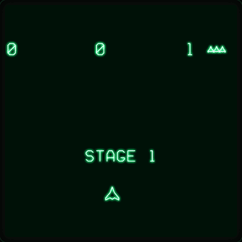

# Galaga for the oscilloscope

The game is drawn as lines, like a vector arcade game. The picture is also a sound: the **left channel is X** and the **right channel is Y**.
Put an oscilloscope in X/Y mode on the headphone jack, and it shows the game. A software scope on the page shows the same picture, so you need no hardware.

**[▶ Play it here](https://shadester.github.io/galagas/scope/)**



## How it works

- The rules are the Rust core of [`../tui`](../tui) (a translation of `../psp/game.c`, the arcade rules, 40 aliens). It is the same WebAssembly module as the terminal page.
- `tui/src/scope.rs` turns the state of the game into line segments: our own line drawings of the aliens, the ship, shots, bombs, the tractor beam and explosions, a stroke font for the numbers and messages.
  A frame has at most 480 lines.
  The lines are put in an order that is short for the beam (a greedy nearest-neighbour search that also turns a line round when its end is nearer). It makes the jumps between lines 35 to 50 percent shorter, so the picture repeats faster.
- The page walks every line at a constant speed (one sample for every 160 units of a 4096 x 4096 box) and jumps between lines. That gives 48,000 samples a second.
  A frame of 200 lines needs about 800 samples, so the picture repeats about 60 times a second. A busier frame takes longer, and the picture flickers a little. This is the same limit a real vector display has.
- **XY out** starts the audio: the stereo signal is the picture, and nothing else (there are no sound effects: a scope output cannot also carry them). With XY out off, the page is silent. A browser starts audio only after a click or a key, so with `?xy` it starts at the first one.
  Through speakers the signal sounds like a harsh buzz (the picture repeats about 60 times a second).
- **The software scope is a model of a real one.** It reads only the signal (the samples), never the line list of the game. The beam follows the samples in real time (48,000 a second),
  with a limited bandwidth (it covers 85% of a step in one sample, so corners round a little). It draws a line as bright as it is slow, because the same energy goes over a longer path.
  Nothing blanks the beam, so the jumps between lines show too, dim because the beam is about 6 times as fast there. The phosphor decays over time (the **Persistence** knob, 30 ms to begin with),
  and **Brightness** scales the beam. When a frame has many lines the picture repeats more slowly and flickers, as on a real scope.
- The panel on the right shows the real samples of one frame: L (X) in green and R (Y) in blue.

## Use a real oscilloscope

1. Use a 3.5 mm audio cable to BNC (or two BNC leads): left channel to the X input (CH1) and right channel to the Y input (CH2).
2. Set the scope to X/Y mode. Set both channels to **DC coupling** (AC coupling slowly moves the picture). Use about 0.5 V per division to begin.
3. Press **XY out** (or open the page with `?xy` and press any key), and turn the volume of the computer up (the signal is a full-scale audio signal).
4. Turn the brightness of the scope up a little. The picture is built from many short lines, so it is dimmer than a static drawing.

The audio chain of a computer can add a small filter, and some sound cards cut very low frequencies. If the picture drifts or is skewed, check the coupling and the volume first.
I could not test a real oscilloscope while I wrote this: the software scope and the samples are tested, the output on a real scope is not.

## Options and keys

`?autoplay` (the ship plays itself), `?god` (the ship cannot be hit), `?stage=N`, `?xy` (XY out on: the audio starts at the first key or click).
Arrow keys or A / D move, Space fires, P pauses.

## Build and test

```sh
cd ../tui
tools/build_web.sh            # docs/tui/galaga.wasm and docs/scope/galaga.wasm
cargo test --lib              # the scope tests are in src/scope.rs
python3 tests/test_scope.py   # headless Chromium (needs playwright)
python3 tools/make_scope_gif.py   # scope/docs/gameplay.gif
cargo run --release --example scope_svg --no-default-features -- 1300 out.svg   # one frame as an SVG
```
