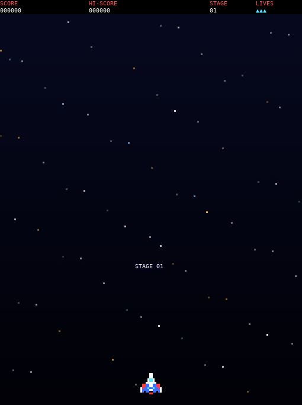

# Galaga for the terminal

A Galaga clone for the terminal, written in Rust. It plays by the rules of the arcade Galaga (see [`../ARCADE.md`](../ARCADE.md)): 40 aliens,
the arcade fly-in waves and flight paths, the dive scheduler with escorts, aimed bombs, a formation that swings and then breathes, the tractor
beam, and challenge stages. The picture is pixel art made of half-block characters in 24-bit colour; the sprites are our own.



## Build and run

You need [Rust](https://rustup.rs/) (on Arch Linux and derivatives, `tools/setup-linux.sh` installs it with the tools of the tests). The only crate is `crossterm`. The same rules and renderer also run in the browser
(**[▶ play it here](https://shadester.github.io/galagas/tui/)**): Rust compiled to WebAssembly, drawn on a canvas as terminal cells.

```sh
cargo run --release            # or tools/run.sh
tools/run.sh --autoplay        # the ship plays itself
```

**The field.** The game plays in the arcade's own portrait field (x 0..203, y 0..253, 16 x 16 sprites, the rows 16 units apart, the ship far below
the formation, as in the arcade and in the Lynx and NES versions; `../psp/game.c` with `-DRULES_PORTRAIT`). It is tall and narrow, so the window
must be at least 51 x 35 cells (half blocks); the image and octant modes below fit smaller and taller windows. `--landscape` plays the C64's field
(320 x 200: the formation rows are 28 pixels apart and the ship is close below them), which needs a window of at least 80 x 27. The browser
version ([▶ play it here](https://shadester.github.io/galagas/tui/)) and the oscilloscope page also play the portrait field; add `?landscape` to the address for the C64's.

Use a terminal with 24-bit colour (iTerm2, kitty, WezTerm, Alacritty, GNOME Terminal, Windows Terminal; Terminal.app has 256 colours and looks worse).
The picture grows with the window: with half blocks, in the landscape field 80 x 27 (4 game pixels for a terminal pixel), 107 x 36 (3), or
160 x 52 (2); in the portrait field 51 x 35 (4), 68 x 46 (3), or 102 x 67 (2). Resize the window while you play if you like.

**Real pixels in kitty and Ghostty.** These terminals have the kitty graphics protocol, and the game then sends the play area as an image
(the 16 x 16 art keeps its eyes, antennae and wings, without the half-block reduction). The text stays text. The picture grows with the window
in small steps, from 427 x 267 pixels (43 x 16 cells of 10 x 20 pixels) up to 2133 x 1333, and nearly fills it. The sprites are whole multiples of
the art (2 to 8 times), the positions follow the scale. Each picture is a new image and the old one is deleted after it, so it does not flash.
It needs a terminal that tells the size of its cells in pixels; the game finds the terminal from `TERM` / `TERM_PROGRAM`, and does not use images
inside tmux or screen. A big window costs time: a frame of 2133 x 1333 takes about 30 ms to draw and compress, so the game may draw fewer than
30 pictures a second there (the game speed stays the same).

**Octants.** With `--octants` (or in kitty when the terminal does not tell its cell size, and when the window is too small for the image) a cell is
2 x 4 pixels, drawn with the octant block characters (Unicode 16, `src/octant.rs`): 4 times the pixels of the half blocks, only text, so it works
over ssh. A cell has two colours only: where a cell has more, the game keeps the two that fit best (the shape stays, the colours are reduced).
The picture grows in 7 steps, from 160 x 100 pixels (80 x 27 cells) to 480 x 300 (240 x 77 cells). It needs a font with the octants.

`--pixels` forces the image (for another terminal with the protocol), `--octants` the octants, and `--blocks` the half blocks (when your font shows
boxes instead of the octants, or you want the old look).

## Controls

| Key | Action |
|-----|--------|
| A / D or the left / right arrows | Move the ship |
| Space (or K, Enter, up arrow) | Fire, start the game |
| P | Pause / resume |
| Q or Esc | Quit to the title screen; on the title screen: leave the program |
| Ctrl-C | Leave at once |

A terminal sends key presses but usually no key releases. With the kitty keyboard protocol (kitty, WezTerm, iTerm2, Ghostty, recent Alacritty) the
game gets the releases and the ship moves exactly as long as the key is down. Without it a key counts as held for a short time after the last
press or repeat: the ship moves a little after you let go, and there is a short pause before the key repeat starts. Each press fires one shot.

The hi-score is saved in `~/.local/share/galaga-tui/hiscore`.

## Options

| Option | Effect |
|--------|--------|
| `--autoplay` | Synthetic input (sweeps left and right and fires) |
| `--stage N` | Start at stage N (3 is a challenge stage) |
| `--god` | The ship cannot be hit |
| `--landscape` | Play the C64's field (320 x 200) instead of the arcade's portrait field |
| `--no-save` | Do not read or write the hi-score file |
| `--pixels`, `--octants`, `--blocks` | Draw as an image (kitty graphics protocol), as octant characters (2 x 4 pixels a cell), or as half blocks (1 x 2); the default is the image in kitty and Ghostty, else half blocks |
| `--help` | Print the keys and the options |

## Tests and tools

```sh
python3 tests/test_lockstep.py [ticks] [scenario ...]   # src/game.rs against psp/game.c: the same state after every tick, 16 scenarios (8 landscape, 8 portrait: p_...)
python3 tests/test_terminal.py                          # the program in a pseudo-terminal: start, leave, resize, key releases, the image and octant modes
tools/build_web.sh                                      # the browser version: ../docs/tui/galaga.wasm (rustup target add wasm32-unknown-unknown)
python3 tests/test_web.py                               # the browser version in headless Chromium (playwright): draws, keys, hi-score, same game as native
cargo test --release                                    # layouts, drawing of every state (half blocks, octants, pixels), the octant cells, base64 and image commands, palette
cargo run --release --example pixels_ppm -- 1500 out.ppm [cols rows cell_w cell_h] [stage]   # a frame of the image mode as a PPM, and its size and time
cargo run --release --example octants_ppm --no-default-features -- 1500 out.ppm [cols rows] [stage]   # a frame of the octant mode as a PPM (2 colours a cell)
python3 tools/gen_octants.py [--check]                  # src/octant.rs: the character for each pattern of 2 x 4 pixels
python3 tools/gen_arcade_rs.py                          # src/arcade_data.rs and src/arcade_data_portrait.rs from ../psp/arcade_data.h and arcade_data_portrait.h
python3 tools/gen_art_rs.py                             # src/art.rs from ../psp/art.h
python3 tools/make_gif.py [cols rows seconds]           # docs/gameplay.gif (needs pillow and pyte)
```

## Source layout

| File | Contents |
|------|----------|
| `src/game.rs` | The rules: a translation of `../psp/game.c`, with the same names. `Geo` has the numbers of a field (the G_* macros of `game.h`): `LANDSCAPE` and `PORTRAIT` |
| `src/arcade_data.rs`, `src/arcade_data_portrait.rs`, `src/art.rs`, `src/octant.rs` | Generated: the arcade numbers (and the 4 tables of the portrait field that differ), our pixel art, the octant characters |
| `src/render.rs` | The state of the game becomes a frame of terminal cells (canvas, sprites, text; half blocks or octants), and for the image mode a canvas |
| `src/term.rs` | Raw mode, the alternate screen, writing only the cells that changed, the image (kitty graphics protocol) |
| `src/input.rs` | Keys to the input of the game |
| `src/hiscore.rs`, `src/main.rs` | The hi-score file; the loop at 50 ticks a second |
| `src/web.rs`, `../docs/tui/index.html` | The browser version: exported functions of the WebAssembly module, and the page (keys, canvas, 50 ticks a second, hi-score in `localStorage`) |
| `examples/trace.rs` | Prints the state after every tick (for the lockstep test) |
